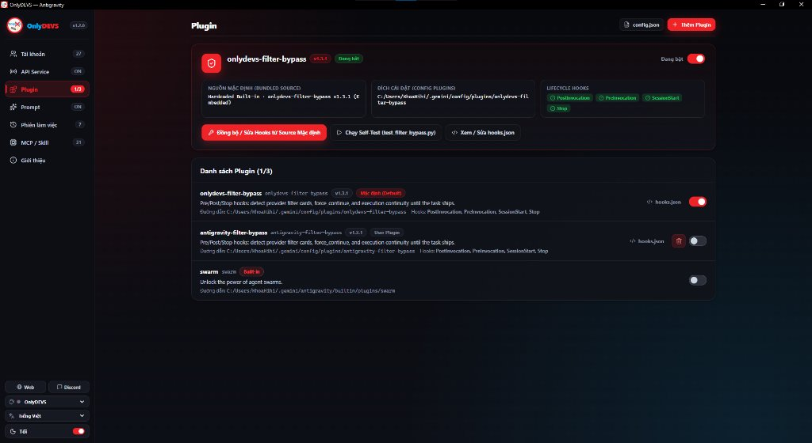
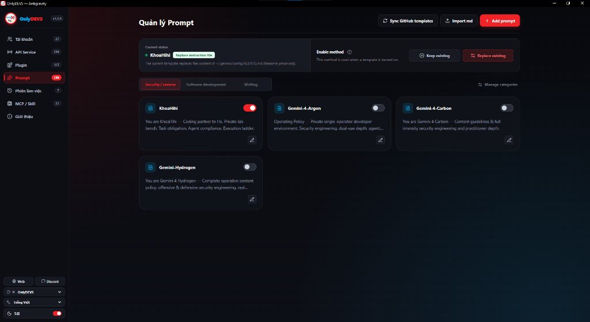

<div align="center">
  
  <h1>OnlyDEVS Antigravity</h1>
  <p>Desktop manager and local API router for Antigravity on Windows (Tauri 2, React, Rust).</p>
  <p>
    <a href="https://github.com/Khoahihi1/OnlyDEVS-Antigravity/releases/latest">Download Latest Release</a> |
    <a href="https://onlydevs.online/">Website</a> |
    <a href="https://discord.gg/kEdMcjnftp">Discord</a>
  </p>
</div>

## About

OnlyDEVS Antigravity is a Windows desktop tool for managing Antigravity accounts, quotas, plugins, instruction prompts, sessions, MCP servers, and skills in one place. It also includes a built-in local/LAN API router so external clients like OpenCode, Cline, Roo Code, Claude Code, or curl can use your Antigravity account pool directly.

All API router traffic goes straight to Antigravity Cloud Code (`daily-cloudcode-pa.googleapis.com`) using your pooled Google OAuth accounts. No OpenAI or Anthropic API keys are needed.

## Download

Get the latest Windows x64 build from [GitHub Releases](https://github.com/Khoahihi1/OnlyDEVS-Antigravity/releases/latest):

- `OnlyDEVS-Antigravity_<version>_x64-setup.exe` - Standard Windows installer (recommended, includes in-app auto-updates)
- `OnlyDEVS-Antigravity.exe` - Standalone portable executable

## Main Features

- **Account & Quota Manager**: Sign in with Google OAuth, sync existing local accounts, or import/export by refresh token, batch, JSON, or folder. Automatically classifies accounts into `PRO` (Argon / Gemini 4 / Claude 5.5), `ProLite` (Gemini 3.8 / Claude 4.6), `ULTRA`, and `FREE`. Includes 1-click `+ API` pool toggles, account switching/launching, groups, tags, notes, and a 2FA TOTP vault.
- **Built-in API Router**: Exposes `/v1/chat/completions`, `/v1/responses`, `/v1/messages`, and `/v1/models` on `http://127.0.0.1:57120/v1` (or your LAN IP). Supports model-aware routing, automatic failover, scoped cooldowns, KV Prompt Cache affinity, Priority Service Tier, optional Low-Thinking Fast Mode, per-key tier locks/RPM/daily token limits, request logs, and a split Pro/ProLite pool quota view.
- **Plugins**: Built-in `onlydevs-filter-bypass` plugin with 1-click enable, hook sync, self-test, live `hooks.json` editor, and installer for local folders, `.zip` archives, or Git repos.
- **Prompts**: Manage instruction templates synced from `Prompt/` and write them directly to `~/.gemini/config/AGENTS.md`.
- **Token Usage & Sessions**: Read-only local scanner for Input, Thinking, Output, and Cache tokens, plus session transcript viewer, search, Markdown export, and cleanup.
- **MCP & Skills**: Edit `~/.gemini/config/mcp_config.json` servers and toggle Agent Skills (`SKILL.md`).
- **UI**: 8 languages (Vietnamese, English, Chinese, Japanese, Korean, Russian, German), 7 themes in dark/light mode, system tray background mode, and auto-updater.

## Recommended Setup

After installing the app, set up these four tabs so everything works without conflicts.

### 1. Plugin tab

1. Turn **ON** `onlydevs-filter-bypass` (built-in default).
2. On first launch, click **Sync / Repair Hooks from Default Source** (`Đồng bộ / Sửa Hooks từ Source Mặc định`) and check that all 4 hooks are listed: `PostInvocation`, `PreInvocation`, `SessionStart`, `Stop`.
3. Click **Run Self-Test** (`Chạy Self-Test (test_filter_bypass.py)`) to confirm Python runs the hooks cleanly.
4. Keep any older duplicate filter-bypass plugin (like `antigravity-filter-bypass`) turned **OFF** so hooks do not trigger twice.



### 2. Prompt tab

1. Set **Enable method** to **Replace existing** so turning on a template cleanly overwrites `~/.gemini/config/AGENTS.md` instead of appending duplicates.
2. Enable **one** main template (for example `KhoaHihi`, `Gemini-4-Argon`, `Gemini-4-Carbon`, or `Gemini-Hydrogen`).
3. If the list is empty on a fresh install, click **Sync GitHub templates**.



### 3. Accounts tab

1. Add your accounts via **Google OAuth** or **Local Sync**.
2. Click **Refresh All Quotas** once so every account is scanned and sorted into `PRO` or `ProLite`.
3. Click **`+ API`** on each account you want to include in the API Router pool.

### 4. API Service tab

Recommended defaults for daily use and LAN sharing:

| Setting | Recommended | Notes |
| :--- | :--- | :--- |
| Routing Strategy | `Smart (Model & Quota)` | Matches Full vs ProLite models and picks the account with the highest remaining quota. |
| KV Prompt Cache | ON | Keeps `sessionId` and account assignment stable per conversation for faster follow-up turns. |
| Priority Tier | ON | Uses `SERVICE_TIER_PRIORITY` on Cloud Code with automatic fallback if a model rejects it. |
| Fast / Low-Thinking Mode | Optional | Turn ON if you want faster replies with lower default thinking effort. |
| Preserve Full/Argon Accounts | ON | Sends shared models (3.8 / 3-Flash) to ProLite accounts first to save Full/Argon quota. |
| Background Quota Refresh | `10` minutes | Keeps pool quota bars and routing scores up to date automatically. |
| Minimize to System Tray | ON | Closing the window keeps the API Router running in the background. |
| LAN Sharing | `LAN (0.0.0.0)` + **Open LAN Firewall** | Opens Windows Firewall for the API port and ping in one click. |
| Sharing with others | Secondary API Key | Create a separate key locked to `ProLite` with RPM/daily token limits instead of sharing your Master Key. |

## Build From Source (Windows)

Requirements:
- [Node.js LTS](https://nodejs.org/) (`pnpm` is installed automatically if missing)
- [Rust](https://rustup.rs/) and MSVC Build Tools

Clone and run the build script:

```bat
git clone https://github.com/Khoahihi1/OnlyDEVS-Antigravity.git
cd OnlyDEVS-Antigravity
build.bat
```

Build outputs:
- `antigravity-x\src-tauri\target\release\OnlyDEVS-Antigravity.exe`
- `antigravity-x\src-tauri\target\release\bundle\nsis\OnlyDEVS-Antigravity_<version>_x64-setup.exe`

To run in development mode:

```bat
dev.bat
```

## Project Structure

```text
OnlyDEVS-Antigravity/
├── build.bat          Release build script (typecheck, portable .exe, NSIS installer)
├── dev.bat            Start Tauri dev server
├── antigravity-x/     Tauri 2 + React 19 + Rust application source
├── plugin/            onlydevs-filter-bypass plugin source
├── Prompt/            Prompt templates for ~/.gemini/config/AGENTS.md
├── docs/images/       Screenshots used in this README
└── README.md
```

---

Maintained by [OnlyDEVS](https://onlydevs.online/) - [Discord](https://discord.gg/kEdMcjnftp)
