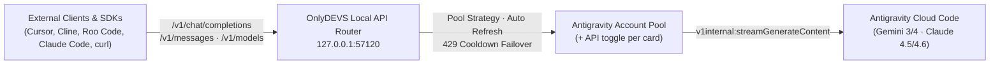

<div align="center">
  

  <h1>OnlyDEVS — Antigravity</h1>

  <p>
    <strong>All-in-One Control Suite & Local API Router for Antigravity</strong><br/>
    Built with Tauri 2 · React 19 · Rust · Styled in OnlyDEVS Crimson × OnlyBlue
  </p>

  <p>
    <a href="https://github.com/Khoahihi1/OnlyDEVS-Antigravity/releases/latest">
      
    </a>
    
    
    <a href="https://onlydevs.online/">
      
    </a>
    <a href="https://discord.gg/kEdMcjnftp">
      
    </a>
  </p>
</div>

---

## ✨ Overview

**OnlyDEVS — Antigravity** (`OnlyDEVS-Antigravity.exe`) is a native desktop suite purpose-built **100% for Antigravity** — managing accounts, live quota pools, local token usage analytics, plugins, prompts, sessions, MCP/Skills, and a built-in **Antigravity Cloud Code API Router**.

### Core Modules

| Module | What It Does |
| :--- | :--- |
| **👤 Accounts** | Google OAuth 2.0 login, local account sync, Refresh Token / Batch / JSON & folder import-export. Live quota buckets (`Gemini · 5h`, `Gemini · Weekly`, `Claude · 5h`, `Claude · Weekly`, `Gemini 4 Argon`, `Gemini 4 Carbon`). 1-click **`+ API / API ✓`** pool toggle on every card, **Launch / Switch Account Popup** (auto-detects installed Antigravity targets, graceful restart & full credential sync), Groups, Custom Sort, Tags, Privacy Mode, Notes, 2FA TOTP Vault, and Switch History. |
| **📊 Session Token Usage** | Read-only local scanner separating **Input / Thinking / Output / Cache** tokens with interactive SVG trend charts, model/workspace/type cross-filtering, conversation table, and per-turn breakdown. |
| **⚡ API Service Router** | **Pure Antigravity Cloud Code proxy** (`cloudcode-pa.googleapis.com` / `daily-cloudcode-pa.googleapis.com`) powered solely by your pooled Antigravity OAuth accounts. Exposes standard local/LAN compatibility endpoints (`/v1/chat/completions`, `/v1/models`, `/v1/messages`) so external editors & SDKs can consume your Antigravity quota directly. |
| **🧩 Plugins** | Hardcoded built-in `antigravity-filter-bypass v1.3.1` one-click toggle, self-test runner, live `hooks.json` & `config.json` editors, plus Folder / `.ZIP` / Git URL / Custom Manifest installer. |
| **📝 Prompts** | Curated instruction prompt library synced with `Prompt/` — toggling a prompt writes directly to `~/.gemini/config/AGENTS.md`. |
| **💬 Sessions** | Scan, search, group by workspace, inspect transcripts, sync, export to Markdown, and batch delete. |
| **🛠️ MCP & Skills** | Manage `~/.gemini/config/mcp_config.json` servers and Agent Skills (`SKILL.md`). |
| **🎨 Themes, i18n & Auto-Update** | 8 languages (`VI`, `EN`, `简体中文`, `繁體中文`, `JA`, `KO`, `RU`, `DE`), 7 themes (`OnlyDEVS`, `Nord`, `Tokyo Night`, `Catppuccin`, `Gruvbox`, `Everforest`, `OLED Pure`) in Dark & Light modes, and GitHub Releases auto-updater with live download progress. |

---

## ⚡ How the Built-in Antigravity API Router Works

> **100% Antigravity Upstream — Zero Third-Party API Keys Required**  
> The router **never** connects to OpenAI or Anthropic servers. Every request is translated and forwarded exclusively to **Antigravity Cloud Code** (`cloudcode-pa.googleapis.com` / `daily-cloudcode-pa.googleapis.com`) using the OAuth tokens of the Antigravity accounts in your pool.



- **Why standard `/v1/*` routes?** Providing OpenAI-style (`/v1/chat/completions`, `/v1/models`) and Anthropic-style (`/v1/messages`) inbound compatibility lets any third-party tool point its Base URL to `http://127.0.0.1:57120/v1` and use your Antigravity quota with streaming, thinking, tool calls, and automatic account failover.
- **Routing & Management:** Supports `highest_quota`, `round_robin`, `sticky_session`, and `failover` strategies, automatic OAuth refresh on `401`, automatic cooldown recovery on `429`/`5xx`, scoped API keys, custom model alias rules, live playground, request logs inspector, and dedicated API usage analytics.

---

## 📥 Download (Pre-built)

Grab the latest Windows x64 installer or portable binary from [**GitHub Releases**](https://github.com/Khoahihi1/OnlyDEVS-Antigravity/releases/latest):

- `OnlyDEVS-Antigravity_<version>_x64-setup.exe` — **Recommended NSIS Installer** (supports in-app Auto-Update)
- `OnlyDEVS-Antigravity.exe` — **Standalone Portable Binary**

---

## 🔨 Build From Source (Windows)

### Prerequisites
- [Node.js LTS](https://nodejs.org/) (auto-installs `pnpm` if missing)
- [Rust / Cargo](https://rustup.rs/) + MSVC Build Tools

### One-Click Build

Clone the repository and double-click **`build.bat`** at the root folder, or run:

```bat
git clone https://github.com/Khoahihi1/OnlyDEVS-Antigravity.git
cd OnlyDEVS-Antigravity
build.bat
```

Output artifacts:
- Portable binary: `antigravity-x\src-tauri\target\release\OnlyDEVS-Antigravity.exe`
- NSIS Installer: `antigravity-x\src-tauri\target\release\bundle\nsis\OnlyDEVS-Antigravity_<version>_x64-setup.exe`

For live development mode:
```bat
dev.bat
```

---

## 📁 Repository Structure

```text
OnlyDEVS-Antigravity/
├── build.bat            # One-click Windows release builder (typecheck + .exe + NSIS installer)
├── dev.bat              # Launch Tauri dev server from root
├── antigravity-x/       # Tauri 2 + React 19 + Rust desktop application source
├── plugin/              # antigravity-filter-bypass plugin source (also embedded in binary)
├── Prompt/              # Instruction prompt templates synced into ~/.gemini/config/AGENTS.md
└── README.md            # Documentation
```

---

<div align="center">
  <strong>Built by <a href="https://onlydevs.online/">OnlyDEVS</a></strong> · <a href="https://discord.gg/kEdMcjnftp">Discord Community</a>
</div>
