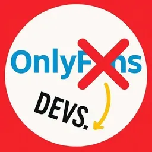
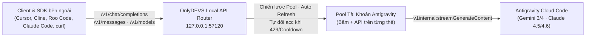

<div align="center">
  

  <h1>OnlyDEVS — Antigravity</h1>

  <p>
    <strong>Bộ Công Cụ Quản Lý Toàn Diện & Local API Router Thuần Antigravity</strong><br/>
    Xây dựng trên Tauri 2 · React 19 · Rust · Giao diện chuẩn màu OnlyDEVS Crimson × OnlyBlue
  </p>

  <p>
    <a href="README.md">🇬🇧 English</a> &nbsp;·&nbsp; <strong>🇻🇳 Tiếng Việt</strong>
  </p>

  <p>
    <a href="https://github.com/Khoahihi1/OnlyDEVS-Antigravity/releases/latest">
      
    </a>
    
    
    <a href="https://onlydevs.online/">
      
    </a>
    <a href="https://discord.gg/kEdMcjnftp">
      
    </a>
  </p>
</div>

---

## ✨ Giới thiệu

**OnlyDEVS — Antigravity** (`OnlyDEVS-Antigravity.exe`) là ứng dụng desktop viết bằng Rust + React thiết kế **thuần 100% cho Antigravity** — gom trọn quản lý tài khoản, theo dõi hạn mức thời gian thực, thống kê token cục bộ, plugin, prompt, phiên hội thoại, MCP/Skill và tích hợp sẵn **Antigravity Cloud Code API Router**.

### Tính năng chính

| Phân mục | Chi tiết |
| :--- | :--- |
| **👤 Tài khoản** | Đăng nhập Google OAuth 2.0, đồng bộ tài khoản trên máy, nhập/xuất Refresh Token · Hàng loạt · JSON & thư mục. Hiển thị trực tiếp hạn mức Cloud Code (`Gemini · 5h`, `Gemini · Weekly`, `Claude · 5h`, `Claude · Weekly`, `Gemini 4 Argon`, `Gemini 4 Carbon`). Nút **`+ API / API ✓`** thêm/gỡ nhanh khỏi API pool ngay trên từng thẻ tài khoản, **Popup chọn bản khi bấm chạy tài khoản** (tự nhận diện bản cài trên máy, đóng sạch tiến trình cũ & đồng bộ credential đầy đủ), Nhóm tài khoản, Sắp xếp tùy chỉnh, Thẻ (Tag), Chế độ ẩn danh, Ghi chú, Kho mã 2FA TOTP và Lịch sử chuyển. |
| **📊 Thống kê Token phiên** | Quét chỉ đọc (read-only) dữ liệu cục bộ, tách riêng **Đầu vào / Suy luận (Thinking) / Đầu ra / Bộ đệm**, biểu đồ xu hướng SVG tương tác, lọc chéo theo mô hình/thư mục/loại phiên và xem chi tiết từng lượt trả lời. |
| **⚡ Dịch vụ API (Router)** | **Proxy thuần Antigravity Cloud Code** (`cloudcode-pa.googleapis.com` / `daily-cloudcode-pa.googleapis.com`), chạy hoàn toàn bằng pool tài khoản OAuth Antigravity của bạn. Mở cổng tương thích cục bộ/LAN (`/v1/chat/completions`, `/v1/models`, `/v1/messages`) để mọi công cụ & SDK bên ngoài cắm trực tiếp vào dùng hạn mức Antigravity. |
| **🧩 Plugin** | Tích hợp sẵn `antigravity-filter-bypass v1.3.1` bật/tắt 1 chạm, chạy tự kiểm tra (self-test), sửa trực tiếp `hooks.json` & `config.json`, hỗ trợ cài thêm plugin từ Thư mục / `.ZIP` / Git URL / Manifest. |
| **📝 Prompt** | Kho prompt chỉ dẫn đồng bộ với thư mục `Prompt/` — gạt công tắc để ghi trực tiếp vào `~/.gemini/config/AGENTS.md`. |
| **💬 Phiên (Session)** | Quét, tìm kiếm, gom theo workspace, xem transcript đầy đủ, đồng bộ, xuất Markdown và xóa hàng loạt. |
| **🛠️ MCP & Skill** | Quản lý máy chủ MCP (`~/.gemini/config/mcp_config.json`) và Agent Skills (`SKILL.md`). |
| **🎨 Giao diện, Đa ngôn ngữ & Auto-Update** | Hỗ trợ 8 ngôn ngữ (`VI`, `EN`, `简体中文`, `繁體中文`, `JA`, `KO`, `RU`, `DE`), 7 bảng màu (`OnlyDEVS`, `Nord`, `Tokyo Night`, `Catppuccin`, `Gruvbox`, `Everforest`, `OLED Pure`) cho cả chế độ Sáng/Tối, tự kiểm tra & tải cập nhật trực tiếp từ GitHub Releases. |

---

## ⚡ Cơ chế hoạt động của API Router thuần Antigravity

> **100% Upstream Antigravity Cloud Code — Không gọi OpenAI hay Anthropic**  
> API Router **chỉ** gọi tới hệ thống nội bộ của **Antigravity Cloud Code** (`cloudcode-pa.googleapis.com` / `daily-cloudcode-pa.googleapis.com`) bằng OAuth token từ các tài khoản Antigravity trong pool.



- **Vì sao có endpoint `/v1/chat/completions` và `/v1/messages`?** Đó chỉ là **lớp chuẩn hóa giao thức đầu vào** để các app/extension/SDK bên ngoài có thể trỏ `Base URL = http://127.0.0.1:57120/v1` vào dùng trực tiếp hạn mức Antigravity (hỗ trợ đầy đủ streaming, thinking, tool call).
- **Quản trị chuyên sâu:** Chọn chiến lược xoay vòng (`highest_quota`, `round_robin`, `sticky_session`, `failover`), tự làm mới token khi `401`, tự đưa vào cooldown & chuyển tài khoản khi gặp `429`/`5xx`, quản lý nhiều API Key kèm giới hạn model/account, quy tắc alias model, playground test trực tiếp, nhật ký gọi và biểu đồ thống kê usage riêng cho API.

---

## 📥 Tải bản dựng sẵn

Tải bộ cài Windows x64 mới nhất tại [**GitHub Releases**](https://github.com/Khoahihi1/OnlyDEVS-Antigravity/releases/latest):

- `OnlyDEVS-Antigravity_<version>_x64-setup.exe` — **Bộ cài NSIS (Khuyên dùng)**, hỗ trợ tự cập nhật trong app.
- `OnlyDEVS-Antigravity.exe` — **Bản chạy ngay (Portable)** không cần cài đặt.

---

## 🔨 Tự Build từ mã nguồn (Windows)

### Yêu cầu môi trường
- [Node.js LTS](https://nodejs.org/) (script sẽ tự cài `pnpm` nếu máy chưa có)
- [Rust / Cargo](https://rustup.rs/) + MSVC Build Tools

### Build 1 chạm

Clone repo và nhấp đúp file **`build.bat`** ở ngay thư mục ngoài cùng, hoặc chạy lệnh:

```bat
git clone https://github.com/Khoahihi1/OnlyDEVS-Antigravity.git
cd OnlyDEVS-Antigravity
build.bat
```

File đầu ra sau khi build:
- Bản Portable: `antigravity-x\src-tauri\target\release\OnlyDEVS-Antigravity.exe`
- Bản cài đặt NSIS: `antigravity-x\src-tauri\target\release\bundle\nsis\OnlyDEVS-Antigravity_<version>_x64-setup.exe`

Chạy chế độ phát triển (dev mode):
```bat
dev.bat
```

---

## 📁 Cấu trúc thư mục

```text
OnlyDEVS-Antigravity/
├── build.bat            # Script build release 1 chạm ngoài cùng (typecheck + .exe + NSIS setup)
├── dev.bat              # Khởi chạy nhanh chế độ dev từ thư mục gốc
├── antigravity-x/       # Mã nguồn ứng dụng desktop Tauri 2 + React 19 + Rust
├── plugin/              # Mã nguồn plugin antigravity-filter-bypass (đã nhúng sẵn trong binary)
├── Prompt/              # Bộ mẫu prompt đồng bộ vào ~/.gemini/config/AGENTS.md
├── README.md            # Tài liệu tiếng Anh
└── README.vi.md         # Tài liệu tiếng Việt
```

---

<div align="center">
  <strong>Phát triển bởi <a href="https://onlydevs.online/">OnlyDEVS</a></strong> · <a href="https://discord.gg/kEdMcjnftp">Cộng đồng Discord</a>
</div>
